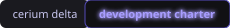

<div align="center">


# Cerium Delta

**Beyond visualization. Toward measurable neural architecture behavior.**

[](https://github.com/NEURAL-Y/cerium-delta/blob/main/LICENSE)
[](https://github.com/NEURAL-Y/cerium-delta/releases/tag/v1.1.3)
[](https://cerium-delta.pages.dev)

[](https://github.com/NEURAL-Y/cerium-delta/blob/main/docs/ARCHITECTURE.md)
[](https://github.com/NEURAL-Y/cerium-delta/blob/main/docs/quick_start.md)
[](https://github.com/NEURAL-Y/cerium-delta/blob/main/docs/Cerium_Delta_Development_Charter.md)

[**Live Demo**](https://cerium-delta.pages.dev) · [**Quick Start**](https://github.com/NEURAL-Y/cerium-delta/blob/main/docs/quick_start.md) · [**Architecture**](https://github.com/NEURAL-Y/cerium-delta/blob/main/docs/ARCHITECTURE.md) · [**Releases**](https://github.com/NEURAL-Y/cerium-delta/releases) · [**Charter**](https://github.com/NEURAL-Y/cerium-delta/blob/main/docs/Cerium_Delta_Development_Charter.md)

</div>

<br>

<div align="center">

</div>

<br>


> 💡 **Tip:** Click any **▶ dropdown** below to expand it. Sections marked *open* are expanded by default. Click the release badges above to see what shipped and what is in development.

---

## ⚡ TL;DR

Cerium Delta is **not** a neural-network drawing tool. Most architecture visualizers answer *"what does the model look like?"* Cerium Delta answers a harder question:

> **How is the model behaving — right now, as it learns?**

It combines **model-state extraction → numerical analysis → architecture-aware metrics → real-time visualization** into a single **observability layer for neural networks**, built on the premise that a model in training is a dynamic system, not a checkpoint.

| | |
|---|---|
| 🧠 **Observes** | Neuron activity, gradients, weights, dropout, layer utilization |
| 📏 **Measures** | **LSS** (Layer Sensitivity Score) and **EQS** (Evolution Quantum Score) — comparable across layers, stages, and models |
| 🔬 **Philosophy** | *A metric should provide evidence, not mythology.* |
| 🔌 **Frameworks** | PyTorch · TensorFlow · JAX · scikit-learn · ONNX |
| 📜 **License** | Apache 2.0 |

---

## 📑 Table of Contents

- [Installation](#-installation)
- [Why Cerium Delta](#-why-cerium-delta)
- [What It Measures](#-what-it-measures)
- [How to Read the Metrics](#-how-to-read-the-metrics)
- [How It Works](#-how-it-works)
- [Reference](#-reference)
- [Contributing](#-contributing)
- [License](#-license)

---

## 🚀 Installation

<details open>
<summary><b>Install and import</b></summary>

<br>

```bash
pip install cerium-delta
```

```python
from cerium_delta.metrics.brain import NVS
# or
from cerium_delta.exporters.dev import bridge
```

For a guided walkthrough, see the **[Quick Start](https://github.com/NEURAL-Y/cerium-delta/blob/main/docs/quick_start.md)**.

</details>

---

## 🎯 Why Cerium Delta

<details open>
<summary><b>The Problem</b></summary>

<br>

Standard evaluation stops at the outcome:

```text
Did the loss decrease?
Did accuracy improve?
Did the model generalize?
```

It rarely answers the *process* questions a developer needs when something breaks:

```text
Which layer changed?
Which layer stopped contributing?
Where did the signal weaken?
Which neurons became inactive?
Did the architecture learn a useful representation?
Did the model become more or less stable during training?
```

Cerium Delta provides the measurements that make these questions answerable.

</details>

<details>
<summary><b>A Simple Mental Model</b></summary>

<br>

Think of a neural network as a machine with many moving components. Traditional evaluation looks only at the machine's final output. Cerium Delta inspects the machine **while it runs**: neuron activity, layer behavior, parameter change, gradient behavior, information propagation. It turns those observations into measurements comparable across layers, training stages, and models.

For researchers and engineers, the same idea is an **observability layer over neural architectures**.

</details>

<details>
<summary><b>External View vs. Internal View</b></summary>

<br>

| External View (outcome) | Internal View (process) |
|---|---|
| Loss | Activity |
| Accuracy | Layer sensitivity (LSS) |
| Precision / Recall / F1 / AUC | Evolution (EQS) |

Traditional metrics answer *how well is the model performing?* Cerium Delta adds *how is the architecture behaving while it gets there?* It connects the two views instead of treating them separately.

</details>

<details>
<summary><b>Vision</b></summary>

<br>

```text
Observe the internal state
        ↓
Measure component behavior (LSS, EQS)
        ↓
Compare components
        ↓
Track evolution
        ↓
Identify meaningful changes
        ↓
Understand architectural behavior
```

Instead of asking only *"did the model learn?"*, Cerium Delta helps ask:

> Which components contributed? Which changed or became underutilized?
> Where did internal behavior degrade? How did the architecture evolve — and can we measure it systematically?

</details>

---

## 📏 What It Measures

<details open>
<summary><b>Neural Activity (low-level observations)</b></summary>

<br>

- Neuron activity and inactivity
- Dead / saturated neurons
- Activation distributions
- Gradient propagation
- Weight evolution
- Dropout behavior
- Layer utilization

These are the foundation from which higher-level analysis is built.

</details>

<details>
<summary><b>Architecture-Level Analysis</b></summary>

<br>

Individual values are rarely enough on their own. Cerium Delta analyzes how components behave **relative to the rest of the architecture**, moving from *"this tensor changed"* to *"this component changed significantly relative to the rest of the architecture."* That distinction is central to the project.

</details>

<details open>
<summary><b>Core Metrics at a Glance</b></summary>

<br>

| Metric | Full name | Purpose |
|---|---|---|
| **LSS** | Layer Sensitivity Score | One layer-level score that unifies *contribution* and *sensitivity*: how much a layer contributes relative to the rest of the network, and how strongly it responds to local or parameter-level change — independent of raw weight magnitude. |
| **EQS** | Evolution Quantum Score | How model state changes relative to a reference state across training, turning *"what is the model now?"* into *"how did the model get here?"* |

<details>
<summary><b>Layer Sensitivity Score (LSS)</b></summary>

<br>

LSS merges two earlier lenses — **Layer Contribution Score (LCS)** and **Sensitivity** — into a single score.

- **Contribution:** does this layer contribute meaningfully to the network, judged *relative to other layers* rather than in absolute terms? Large weights alone don't imply importance.
- **Sensitivity:** how responsive is the layer to local or parameter-level perturbation, regardless of its raw magnitude?

Together, LSS answers: *is this layer both meaningfully contributing and actively responding, compared with the rest of the architecture?*

</details>

<details>
<summary><b>Evolution Quantum Score (EQS)</b></summary>

<br>

EQS is the renamed **Evolution** metric. It tracks state change relative to a reference point across training, making the learning trajectory itself observable rather than only the endpoint. Because it is measured against a reference state, the choice of reference matters (see [How to Read the Metrics](#%EF%B8%8F-how-to-read-the-metrics)).

</details>

<details>
<summary><b>Naming changes (migration note)</b></summary>

<br>

| Previous | Now |
|---|---|
| Layer Contribution Score (LCS) + Sensitivity | **LSS** — Layer Sensitivity Score |
| Evolution | **EQS** — Evolution Quantum Score |

</details>

</details>

<details>
<summary><b>Neural Vitality (research direction)</b></summary>

<br>

A central research question: *is a neural component actively participating in learning, and how does that change over time?* LSS and EQS each offer a different lens on that question. No single metric is a complete verdict. Together they form a **measurement system**, not a single score.

</details>

<details>
<summary><b>Relative Measurement Matters</b></summary>

<br>

A large layer naturally has more parameters than a small one, so a large raw value doesn't automatically mean a component is more important. Cerium Delta leans on **relative analysis**, including percentile-based comparisons and statistical filtering, so components are judged against an appropriate reference population rather than in isolation.

> **Ranking provides context; raw measurements preserve precision.**

</details>

---

## ⚠️ How to Read the Metrics

<details open>
<summary><b>Read these first — they prevent the most common misreadings</b></summary>

<br>

- **Values are relative, not absolute.** A score describes a component *compared with the rest of the architecture*, not a universal grade.
- **Ranking gives context; raw values give precision.** Use ranking to see where a component sits, and the raw measurement when you need exact magnitude.
- **No single metric is a verdict.** LSS and EQS each show a different lens. Look at them together.
- **EQS depends on its reference state.** Choose the reference deliberately and keep it the same when comparing runs.
- **Compare like with like.** Compare layers, training stages, or models only when the measurement setup is the same.
- **A metric points where to look. It does not explain why.** A surprising value is a prompt to investigate, not a conclusion.

</details>

<details>
<summary><b>Common misreadings</b></summary>

<br>

| If you think... | Remember |
|---|---|
| "Large weights mean an important layer." | LSS is relative. Large weights alone don't imply importance. |
| "A big raw value means this component matters more." | Larger components have more parameters, so compare against an appropriate reference population. |
| "One score tells me if the model is healthy." | The metrics form a measurement system, not a single score. |
| "Low accuracy tells me which layer is wrong." | Traditional metrics show the outcome. The internal view shows where behavior changed. |
| "A low value proves a component is useless." | Treat it as evidence to examine, together with the other metrics. |

</details>

---

## 🛠️ How It Works

<details open>
<summary><b>Pipeline</b></summary>

<br>

```text
Model extraction → Internal state → Metric computation
→ Statistical analysis → Interpretation → Visualization
```

Model-state extraction is kept **separate from the analysis layer**, so the core metrics stay framework-independent. Visualization is only one consumer of the underlying measurements — this separation is deliberate.

</details>

<details>
<summary><b>Framework Support</b></summary>

<br>

| Framework | Supported |
|---|:---:|
| PyTorch | ✅ |
| TensorFlow | ✅ |
| JAX | ✅ |
| scikit-learn | ✅ |
| ONNX | ✅ |

See the [Architecture doc](https://github.com/NEURAL-Y/cerium-delta/blob/main/docs/ARCHITECTURE.md) for details on extraction and the analysis layer.

</details>

<details>
<summary><b>Research Philosophy</b></summary>

<br>

> **A metric should provide evidence, not mythology.**

A score isn't meaningful just because it produces a number. Every Cerium Delta metric is expected to carry:

- [x] A mathematical definition
- [x] A clear interpretation
- [x] Known assumptions
- [x] Comparable outputs
- [x] Reproducible computation
- [x] Empirical validation
- [x] Stated limitations

The goal is measurements researchers can inspect, question, reproduce, and improve — not a black box that "just knows."

</details>

---

## 📚 Reference

<details>
<summary><b>Quick Glossary</b></summary>

<br>

| Term | Meaning |
|---|---|
| **Dead neuron** | A neuron that stays inactive, so it contributes nothing to the output. |
| **Saturated neuron** | A neuron pushed into a flat region of its activation function, where it barely responds to changes. |
| **Activation distribution** | How a layer's output values are spread across neurons and inputs. |
| **Gradient propagation** | How the learning signal travels backward through the layers during training. |
| **Weight evolution** | How a layer's weights change over the course of training. |
| **Dropout behavior** | How randomly disabling neurons during training affects activity. |
| **Layer utilization** | How much of a layer's capacity is actually being used. |
| **Reference state** | The earlier model state that EQS is measured against. |
| **Relative analysis** | Judging a component against other components rather than in isolation. |

</details>

<details>
<summary><b>Documentation & links</b></summary>

<br>

| Resource | Link |
|---|---|
| Live demo | [cerium-delta.pages.dev](https://cerium-delta.pages.dev) |
| Quick Start | [docs/quick_start.md](https://github.com/NEURAL-Y/cerium-delta/blob/main/docs/quick_start.md) |
| Architecture | [docs/ARCHITECTURE.md](https://github.com/NEURAL-Y/cerium-delta/blob/main/docs/ARCHITECTURE.md) |
| Development Charter | [docs/Cerium_Delta_Development_Charter.md](https://github.com/NEURAL-Y/cerium-delta/blob/main/docs/Cerium_Delta_Development_Charter.md) |
| Latest release (v1.1.3) | [Release notes](https://github.com/NEURAL-Y/cerium-delta/releases/tag/v1.1.3) |

</details>

---

## 🤝 Contributing

Contributions, questions, and critiques of the metrics are welcome — that's how they improve. Please read the **[Development Charter](https://github.com/NEURAL-Y/cerium-delta/blob/main/docs/Cerium_Delta_Development_Charter.md)** first to understand the project's principles, then open an issue or pull request.

## 📄 License

Released under the [Apache License 2.0](https://github.com/NEURAL-Y/cerium-delta/blob/main/LICENSE).

---

<div align="center">

**Cerium Delta** — Beyond visualization. Beyond conventional metrics.

<sub>⭐ If this project is useful to you, consider starring the repo.</sub>

</div>
